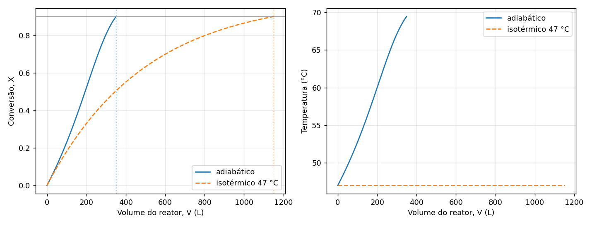

# Aula: PFR adiabático em Python

**Arquivos:** [pfr_adiabatico.py](pfr_adiabatico.py) (código) e [perfis_pfr.png](perfis_pfr.png) (gráfico gerado)

## 1. O problema

Uma reação A → B, irreversível, de 1ª ordem e exotérmica, ocorre em fase líquida num PFR adiabático.

| Grandeza | Valor |
|---|---|
| T₀ | 47 °C = 320,15 K |
| C_A0 | 2,0 mol/L |
| v₀ | 10 L/min |
| k(T₀) | 0,020 min⁻¹ |
| E | 80 kJ/mol |
| ΔH_R | −50 kJ/mol de A |
| ρ·c_p | 4,0 kJ/(L·K) |

Pede-se: o volume para X = 0,90, a temperatura de saída e a comparação com o reator isotérmico a 47 °C.

## 2. Montando o modelo (antes de programar)

O primeiro passo é escrever as equações no papel. O código só traduz o que está aqui.

**Balanço molar no PFR**

$$F_{A0}\,\frac{dX}{dV} = -r_A = k(T)\,C_{A0}(1-X) \quad\Rightarrow\quad \frac{dX}{dV} = \frac{k(T)\,(1-X)}{v_0}$$

**Balanço de energia (adiabático, fase líquida, ρc_p constante)**

Como não há troca de calor, todo o calor liberado pela reação aquece a corrente:

$$T = T_0 + \frac{(-\Delta H_R)\,C_{A0}}{\rho c_p}\,X = T_0 + \underbrace{\frac{50 \cdot 2{,}0}{4{,}0}}_{25\ \text{K}}\,X$$

Esse é o **aumento adiabático de temperatura**: a 100% de conversão a corrente esquentaria 25 K.

**Arrhenius, usando T₀ como referência**

$$k(T) = k_0 \exp\!\left[-\frac{E}{R}\left(\frac{1}{T}-\frac{1}{T_0}\right)\right]$$

O ponto principal é este: o balanço de energia dá **T como função algébrica de X**. Por isso o sistema se reduz a **uma única EDO** em X.

## 3. Por que é preciso resolver numericamente?

No caso isotérmico, k é constante e a integral sai à mão:

$$V_{iso} = \frac{v_0}{k_0}\ln\frac{1}{1-X} = \frac{10}{0{,}02}\ln 10 = 1151\ \text{L}$$

No caso adiabático, k depende de X por meio de T(X), e a integral

$$V = v_0\int_0^{0{,}9}\frac{dX}{k\big(T(X)\big)\,(1-X)}$$

não tem primitiva simples. Aqui entra o computador.

## 4. Lendo o código por partes

### 4.1 Dados em unidades coerentes
Tudo fica em L, min, mol, kJ e K. Um erro clássico é usar R = 8,314 J/(mol·K) junto com E em kJ/mol. No código, `R = 8.314e-3` kJ/(mol·K) mantém tudo coerente.

### 4.2 Cada equação vira uma função
```python
def temperatura(X):
    return T0 + (-dH) * CA0 * X / rho_cp

def k(T):
    return k0 * np.exp(-(E / R) * (1.0 / T - 1.0 / T0))

def dXdV(V, y):
    X = y[0]
    T = temperatura(X)
    return [k(T) * (1.0 - X) / v0]
```
`dXdV` tem o formato que o `solve_ivp` exige: recebe a variável independente (V) e o vetor de estados (y = [X]) e devolve as derivadas.

### 4.3 Parar exatamente em X = 0,90 com um *evento*
O volume não é conhecido de antemão. O que sabemos é a conversão desejada. Por isso integramos até um V grande (5000 L) e pedimos ao integrador que pare quando `X − 0,90` passar por zero:
```python
def atingiu_alvo(V, y):
    return y[0] - X_alvo
atingiu_alvo.terminal = True    # interrompe a integração
atingiu_alvo.direction = 1      # só quando X está subindo
```
O volume procurado fica em `sol.t_events[0][0]`.

### 4.4 Conferência por outro caminho
Também calculamos a integral V = v₀∫dX/[k(1−X)] com `scipy.integrate.quad`. Quando dois métodos independentes dão o mesmo número, o resultado ganha confiança. Vale criar esse hábito.

### 4.5 Isotérmico: fórmula fechada
Basta uma linha com a expressão analítica da seção 3.

## 5. Resultados

```
=== PFR adiabático ===
Volume para X = 0,90:           350.4 L     (solve_ivp)
                                350.4 L     (quad, conferência)
Temperatura de saída:            69.5 °C    (342.65 K)
k na saída:                    0.1439 1/min (7.2x k0)

=== PFR isotérmico a 47 °C ===
Volume para X = 0,90:          1151.3 L

Razão V_iso / V_adiab:           3.29
```

| | Adiabático | Isotérmico (47 °C) |
|---|---|---|
| Volume para X = 0,90 | **≈ 350 L** | **≈ 1151 L** |
| Temperatura de saída | **69,5 °C** | 47 °C |



## 6. Interpretação física

- A reação aquece a própria corrente (+22,5 K até X = 0,9). Com E = 80 kJ/mol, essa elevação multiplica k por cerca de **7**.
- Por isso o reator adiabático precisa de **cerca de 3,3 vezes menos volume** do que o isotérmico.
- No gráfico, a curva X(V) adiabática tem um **ponto de inflexão**. No início, o efeito do aquecimento (k sobe) supera o consumo de A. Perto do fim, o termo (1 − X) domina e a curva achata.
- O ganho vem com um custo: em reações mais exotérmicas, ou com E maior, a mesma lógica leva a pontos quentes e a risco de disparo térmico. Aqui o ΔT adiabático é pequeno (25 K), então não há problema.

## 7. Exercícios para praticar

1. Mude `X_alvo` para 0,99. Quanto cresce cada volume? O caso adiabático fica ainda mais vantajoso?
2. Dobre o calor de reação (ΔH = −100 kJ/mol) e veja o efeito em V e em T_saída.
3. Alimente a 37 °C. Ainda vale a pena operar de forma adiabática?
4. Desafio: troque `temperatura(X)` por uma segunda EDO dT/dV com troca térmica, Ua(T_a − T), e resolva o sistema [X, T] com o `solve_ivp`.

## 8. Como rodar

```bash
python pfr_adiabatico.py
```
O script precisa de `numpy`, `scipy` e `matplotlib` (`pip install numpy scipy matplotlib`).
